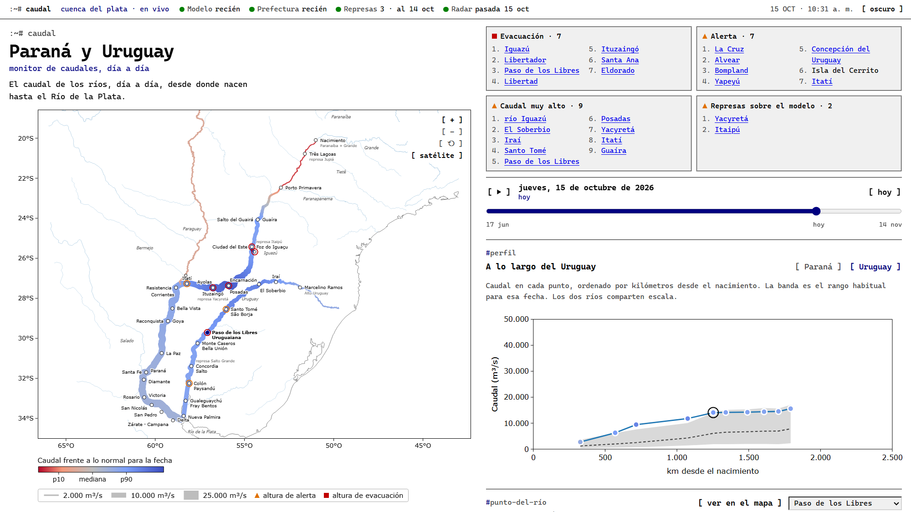

# Paraná y Uruguay



Caudal diario de los ríos Paraná y Uruguay, de sus nacientes al Río de la Plata. Incluye un mapa con zoom y fondo satelital opcional, el perfil a lo largo de cada río, la serie de cada punto, el pronóstico a 30 días, las alturas medidas, el caudal de las represas y la vista satelital. Además:

- un **mapa público de reportes de vecinos** (`/mapa`): cualquiera marca dónde hay agua (calle anegada, viviendas, ruta cortada, río desbordado) y otros vecinos confirman o dicen que ya bajó;
- una **herramienta de análisis** (`/analisis`, con acceso restringido) para administración y autoridades: todas las capas (barrios populares, ríos, rutas, represas) con los reportes encima.

Sin dependencias: solo **Node 22.13 o más nuevo** (la base de datos usa el módulo `node:sqlite` que trae Node).

```
node server.mjs            # http://localhost:8080
PORT=3000 node server.mjs
```

Al arrancar, el servidor descarga los datos. La primera vez calcula también la climatología 2000–2024 de cada punto, lo que tarda unos minutos por los límites de la API. Después actualiza cada 3 horas.

## Base de datos

Todo lo que el servidor guarda vive en **una base SQLite** (`data/caudal.db`, o `$DATA_DIR/caudal.db`), con el módulo `node:sqlite` de Node (`db.mjs`). Sin dependencias y sin otro servicio que mantener. Las tablas:

| tabla | contenido |
|---|---|
| `docs` | instantáneas que el sitio sirve tal cual: `latest` (caudal GloFAS), `extras` (alturas, rutas, satélite, pronóstico del INA), la climatología de cada punto (`clim:…`), los metadatos de cada represa y el estado de las estadísticas |
| `glofas_observed`, `glofas_forecast`, `glofas_issues` | caudal observado/modelado por punto y día, y **cada pronóstico emitido** (uno por día), sin recorte: sirven para comparar después lo pronosticado con lo que pasó |
| `heights` | altura medida por escala y día, sin recorte (el monitor muestra los últimos 400 días) |
| `dam_series` | erogado, aporte, vertido y cota de Itaipú, Yacyretá y Salto Grande, sin recorte |
| `analytics_days` | totales por día de las estadísticas (ver abajo) |
| `reports`, `report_votes` | reportes de vecinos y sus confirmaciones |
| `access_tokens` | accesos de autoridad a la herramienta de análisis (solo el hash) |

Los mosaicos y las imágenes satelitales siguen siendo archivos en `data/tiles/` y `data/sat/` (son binarios y se sirven directo del disco).

**Migración.** La primera vez que arranca una versión con base de datos, el servidor importa los JSON de las versiones anteriores (`latest.json`, `extras.json`, `climatology.json`, `heights-history.json`, `dam-*.json`, `analytics*.json`, `stats-key` y la carpeta `archive/`). Cada archivo se importa una sola vez, queda anotado en `docs` (`migrated:…`) y **no se modifica ni se borra**: sirven de respaldo y permiten volver a la versión anterior. Pasada una semana sin problemas se pueden borrar. El respaldo de la base es copiar `caudal.db` (con el servicio detenido, o con `sqlite3 caudal.db ".backup copia.db"`).

`scripts/admin.mjs` administra la base desde el servidor: crear y resetear usuarios del panel (es el acceso de emergencia), y listar y ocultar reportes.

## Datos

- **Caudal**: GloFAS (Copernicus Emergency Management Service) vía [Open-Meteo Flood API](https://open-meteo.com/en/docs/flood-api). Es un modelo hidrológico diario en una grilla de 0,05°, **no una medición**. Incluye 120 días hacia atrás y 31 de pronóstico (rango p25–p75 del ensamble).
- **Lo normal**: percentiles 10, 50 y 90 de 2000–2024 para cada fecha (ventana de ±10 días).
- **Afluentes del NEA** (Paraguay, Bermejo y Pilcomayo): cada uno se trata según qué tan bien lo sigue el modelo de caudal, que se comprobó contra 3 años de alturas medidas por el INA (correlación de la altura con el logaritmo del caudal GloFAS):

  | Río | Estación | Correlación | Cómo se muestra |
  |---|---|---|---|
  | Bermejo | El Colorado, Sauzalito | 0,88 y 0,92 | caudal modelado y pronóstico, como el Paraná y el Uruguay |
  | Paraguay | Formosa, Puerto Pilcomayo | 0,30 y 0,36 | caudal modelado solo en la desembocadura (0,77 en Isla del Cerrito); en los barrios, la altura medida por Prefectura |
  | Pilcomayo | Misión La Paz, Puesto Jerez, El Raúl | 0,0 a 0,2 | **sin caudal modelado**: trazo punteado y alturas medidas del INA (el cauce cambia y el río se pierde en los esteros) |

  Las alturas del Bermejo y el Pilcomayo vienen de la red de telemetría del INA (series "sat2", `sources/heights-ina.mjs`), sin niveles de alerta. Las trazas se agregan a `public/geo.json` con `scripts/add-tribs-geo.mjs` (a partir de las de Natural Earth).
- **Cartografía**: Natural Earth 10m. Solo agua (ríos, lagos, costa), sin límites políticos.

Fuentes complementarias (módulos opcionales en `sources/`; si uno falla, el resto sigue andando). Se actualizan cada hora y van a la base de datos (documento `extras`):

- **Respaldo de alturas** (`sources/heights-ina.mjs`): si Prefectura no responde (su sitio no es alcanzable desde el VPS), se usan las mismas escalas republicadas por el INA (red `alturas_prefe` de la API A5): 57 puertos, una lectura por día, con niveles de alerta y evacuación. Los que falten salen de `data/umbrales.json`, la última tabla conocida de Prefectura. La barra de estado indica "Alturas · vía INA".
- **Alturas medidas** (`sources/prefectura.mjs`): tabla de Prefectura Naval con altura, alerta, evacuación y tendencia de 91 hidrómetros. El servidor arma su propio histórico (tabla `heights`) y lo completa de a poco con el histórico de 30 días de cada puerto. Pide como máximo 5 por hora, porque el sitio bloquea las ráfagas.
- **Represas** (`sources/dams.mjs`):
  - **Itaipú**: caudal erogado, vertido y nivel, de los datos abiertos del ONS (Brasil). Llega con 1 día de atraso.
  - **Yacyretá**: caudal erogado, del parte de la EBY republicado por el INA (A5).
  - **Salto Grande**: caudal erogado, vertido, aporte y cota, extraídos del sitio de la CTM (saltogrande.org; PDF diario más datos horarios). Cada día cuesta varios pedidos, así que la serie se guarda en `data/dam-saltogrande.json` y se piden solo los días que faltan, una vez por día. Los días anteriores a los últimos 3 se promedian con 4 lecturas horarias, con un error de pocos por ciento. **Ojo:** el sitio rechaza clientes que no se presentan como navegador, y el módulo envía un User-Agent genérico de navegador.
  - Las series de las tres represas se guardan en la tabla `dam_series`.
  - Se comparan con el modelo, que **no conoce las maniobras de compuertas**. Si una represa larga bastante más de lo que estima el modelo, la página lo avisa en las ciudades aguas abajo.
- **Estado de rutas nacionales** (`sources/vialidad.mjs`): lo que informa Vialidad Nacional en [Estado de rutas](https://www.argentina.gob.ar/transporte/vialidad-nacional/estado-de-rutas): habilitada, restringida, corte parcial o corte total por tramo, con observaciones y hora de actualización. La tabla de esa página sale de una planilla pública (hoja `tablavisible`) y el servidor lee esa misma planilla como CSV, a lo sumo cada 30 minutos. **Solo rutas nacionales**: las provinciales las informa cada provincia. Los textos de argentina.gob.ar están bajo CC BY 4.0.
- **Satélite** (`sources/satellite.mjs`): recorte de ~50 km alrededor de cada punto, cacheado en `data/sat/`.
  - **Fondo**: mosaico Sentinel-2 cloudless 2025 de EOX. Licencia CC BY-NC-SA 4.0: **solo uso no comercial**.
  - **Inundación**: Copernicus GFM (radar Sentinel-1, servidor de EODC). Se muestra **una pasada por vez**, la más reciente con detecciones en 14 días, con selector de las anteriores. Acumular días suma artefactos de borde de pasada, que se ven como franjas rectas sobre campos secos.

## Mapa público: reportes de vecinos

`/mapa` (enlace "mapa" en la barra superior): la imagen satelital y, encima, lo que marca la gente. Como contexto muestra las **localidades** y los **ríos con sus medidores** (boyas del INA y escalas de Prefectura: al tocar uno se ve la altura de hoy y sus niveles de alerta y evacuación), con dos casillas para apagarlos (`public/contexto.js`). Las demás capas (barrios populares, rutas, represas) están solo en la herramienta de análisis (más abajo).

- **Reportar** (`+ reportar agua`): se escribe la localidad (el buscador sugiere entre los gobiernos locales de las provincias del mapa y las ciudades vecinas, y lleva el mapa hasta ahí) o, si no aparece, se mueve el mapa a mano. En los dos casos la cruz queda sobre el lugar exacto. **En el celular el reporte tiene dos pasos**: primero se elige el punto, con un panel mínimo para que quede casi todo el mapa libre (y los botones de zoom a la vista), y con "siguiente" se fija el punto y aparecen el tipo, la cantidad de agua y la nota; "cambiar punto" vuelve al paso 1. En la compu todo está junto en un panel a la derecha. Después se elige qué pasa (calle anegada, agua en viviendas, ruta o camino cortado, río desbordado), cuánta agua hay (poca, media, mucha) y, si se quiere, una nota de hasta 140 caracteres sin enlaces. No hace falta cuenta. Hay que acercarse hasta ver la calle para enviar. Los tipos tienen color y forma distintos (círculo, cuadrado, triángulo, rombo).
- **Confirmar**: tocando un reporte se ve el detalle y los reportes parecidos cerca (300 m, 24 h), y cualquiera puede decir "sigue así" (lo renueva por otras 72 horas, hasta 7 días en total) o "ya bajó" (con tres votos de "ya bajó", más que los de "sigue", el reporte deja de mostrarse; "ya bajó" solo se puede votar cuando el reporte tiene al menos 2 horas, para que no se pueda esconder uno recién hecho).
- **Vencimiento**: un reporte dura **72 horas**. En las **últimas 24 horas** pasa a una transición: el marcador se pone gris, con trazo punteado, y se va apagando hasta desaparecer; la ficha dice "por vencer · se retira en N h". Un "sigue así" lo renueva (vuelve a su color y le da otras 72 horas). La base conserva todos (también los vencidos y los ocultos) para la herramienta de análisis.
- La vista y el reporte elegido van en la URL (`#zoom/lat/lon[/rID]`), así que se puede compartir.

**Qué se guarda de cada reporte**: la hora, el punto **redondeado a unos 100 m**, el tipo, la gravedad, la nota y un hash del dispositivo (IP + navegador + sal del día) que sirve para poner límites y contar dispositivos distintos. **No se guarda la IP**, y la sal cambia todos los días: no se puede seguir a nadie de un día a otro. La ubicación del dispositivo (botón "mi ubicación") solo se usa en el navegador para centrar el mapa y no se envía.

**Defensas contra el abuso**
- **Captcha** [Cloudflare Turnstile](https://www.cloudflare.com/products/turnstile/) al enviar un reporte y al confirmar, en modo invisible: solo pide una verificación si Cloudflare lo considera necesario. El script de Cloudflare se carga recién cuando alguien envía algo, no al abrir el mapa. Se activa con las variables `TURNSTILE_SITE_KEY` (clave pública) y `TURNSTILE_SECRET_KEY` (secreta, solo en el servidor); **sin ellas el captcha queda desactivado** y rigen las demás defensas. Para probar sin una cuenta, Cloudflare publica claves de prueba (`1x00000000000000000000AA` y `1x0000000000000000000000000000000AA`) que siempre aprueban.
- Campo trampa en el formulario (los bots lo completan) y tiempo mínimo de 2,5 s entre que se abre el formulario y se envía.
- Límites: 20 reportes por hora por IP y 8 por día por dispositivo; el mismo dispositivo que repite el mismo reporte en el mismo lugar no suma uno nuevo, solo lo renueva.
- Las notas no pueden llevar enlaces ni caracteres mal codificados (`�`); se limpian los caracteres de control y se muestran siempre como texto (nunca como HTML).
- Solo se aceptan puntos dentro de la zona del mapa.
- **Tope global por hora**: 300 reportes nuevos por hora en total (se cambia desde el panel, de 10 a 100.000). Al llegar, los nuevos se rechazan con un mensaje claro hasta que baje y se **avisa por Telegram** (una vez cada 30 minutos). Cuenta los reportes guardados, así que no se reinicia con el servicio.
- **Interruptor de emergencia**: en el panel de administración, "Pausar reportes" deja el mapa en solo lectura: no entran reportes ni confirmaciones, el botón de reportar desaparece y se avisa en pantalla, pero se sigue viendo lo que hay. Se reabre con un clic, y cada cambio avisa por Telegram. Si te están floodeando, es lo primero que conviene apretar.
- **Moderación**: el administrador oculta uno o varios reportes desde el panel de administración (no se borran: quedan para auditar) o con `scripts/admin.mjs ocultar <id>`.

Los reportes son avisos de vecinos **sin verificar** y no reemplazan a los avisos oficiales; el mapa lo dice en pantalla y recuerda el 911.

## Avisos por Telegram (opcional)

`notify.mjs`, sin dependencias: el servidor le manda un mensaje a un chat tuyo cada vez que entra un **reporte nuevo** (tipo, cantidad de agua, localidad más cercana, la nota y un enlace al punto en el mapa) y, a las 21 h (hora de Argentina), un **resumen del día** si hubo uso (visitas, únicos, mapa y monitor, compartidos, reportes nuevos y confirmaciones). Sirve para saber cuándo la app se usa de verdad.

- Para no llenar el chat en una crecida, el primer reporte avisa enseguida y los que llegan en el minuto siguiente salen juntos en un solo mensaje.
- Un aviso que falla no afecta al reporte ni al sitio. El log nunca incluye el token.
- **Configuración**: se crea un bot con [@BotFather](https://t.me/BotFather) (`/newbot`), se le escribe un mensaje al bot (o se lo suma a un grupo) y se abre `https://api.telegram.org/bot<TOKEN>/getUpdates` para leer `chat.id`. Las dos variables van en el mismo `/etc/caudal.env` del captcha: `TELEGRAM_BOT_TOKEN=…` y `TELEGRAM_CHAT_ID=…`. Opcionales: `SITE_URL` (para los enlaces) y `TELEGRAM_API`. Sin las dos primeras no se envía nada.
- **Privacidad**: los avisos llevan el punto del reporte (ya redondeado a ~100 m) y la nota a Telegram, un tercero. Van solo a tu chat; si el chat es un grupo, lo ve todo el grupo.

## Panel de administración (`/admin`)

Es la pantalla principal para **administración y autoridades**: los reportes como una **base de datos** al estilo de Notion (`public/admin.html`, `admin.js`, `admin.css`), con claro y oscuro y adaptada al celular.

- **Tabla** de reportes con estado (vigente, por vencer, vencido, resuelto u oculto), tipo, gravedad, **localidad más cercana**, nota, fecha, vencimiento y votos. Se ordena por cualquier columna y se **filtra** por período, estado, tipo, gravedad y localidad, o se busca por texto o por `#id`. Se puede **agrupar** por localidad, tipo, estado o día.
- **Tablero** por estado, y arriba tarjetas con totales (que filtran al tocarlas) y un gráfico de reportes por día.
- **Detalle** al tocar un reporte: un panel lateral con un mapa satelital del punto, la gravedad, la ubicación, las confirmaciones y la nota, con acciones (ocultar o volver a mostrar, abrir en el mapa de análisis, copiar el enlace público).
- **Acciones en lote** (solo administrador): se marcan varios reportes y se ocultan o se vuelven a mostrar de una vez (hasta 500 por pedido). Un reporte oculto no se borra.
- **Exportar CSV** de lo que se ve con los filtros actuales (para planillas o informes).
- **Guardas contra el flood** (solo administrador): el interruptor para pausar los reportes y el tope por hora, con cuántos entraron en la última hora.
- **Usuarios** (solo administrador): se crean usuarios (administración o autoridad), se resetea su contraseña y se los desactiva. Ver "Acceso" más abajo.
- La **localidad más cercana** (hasta 30 km) la calcula el servidor con la lista de gobiernos locales (`localidades.mjs`).

Se entra con **usuario y contraseña** (ver "Acceso" más abajo); la sesión sirve también para la herramienta de análisis y las estadísticas. Las autoridades ven todo salvo los reportes ocultos y no tienen casillas ni acciones.

## Herramienta de análisis (capas)

El mapa es una herramienta **secundaria** del panel (enlace "Mapa de análisis" en la barra lateral). `/analisis`: un mapa casi a pantalla completa, con zoom hasta cada barrio, para **administración y autoridades**. Reúne todas las capas y los reportes de vecinos. Cruza el caudal con el [Registro Nacional de Barrios Populares](https://datos.gob.ar/dataset/registro-nacional-de-barrios-populares) (RENABAP, Secretaría de Integración Socio Urbana, CC BY 4.0). La vista y el barrio elegido van en la URL (`#zoom/lat/lon/bID`).

**Acceso.** Es la única página que muestra las capas, y sus datos (`layers/*.json`) **no se sirven públicamente**, salvo los ríos y las escalas que usa también el mapa público (`cauces` y `puertos`) y las localidades (`/api/localidades.json`, sin teléfonos ni sitios web). El resto sale de `/api/capas/…`, que exige un acceso en el encabezado `Authorization: Bearer …`. Hay dos tipos:
- **Administración**: puede moderar reportes, usar las guardas contra el flood, ver las estadísticas y administrar usuarios.
- **Autoridad**: **solo lectura**. No ve los reportes ocultos ni las estadísticas, y no tiene acciones ni gestión de usuarios (el servidor lo verifica, no solo la pantalla).

**Ingreso con usuario y contraseña** (`/admin`; `/analisis` y `/stats` usan la misma sesión):
- Las contraseñas se guardan con **scrypt** y sal propia (módulo `crypto` de Node), nunca en texto. Mínimo 12 caracteres.
- La sesión es una **cookie `HttpOnly`, `SameSite=Strict` y `Secure`** (cuando el sitio va por HTTPS) con un código de 256 bits al azar; en la base solo se guarda su hash. Dura 12 horas sin uso y como mucho 7 días, y "salir" la cierra en el servidor. Ningún código ni clave queda en la URL, en el historial ni en el almacenamiento del navegador.
- Los pedidos que cambian datos tienen que venir del propio sitio (se revisa `Origin` o `Sec-Fetch-Site`), además de `SameSite=Strict`.
- **Intentos**: 5 fallos con el mismo usuario desde la misma IP bloquean ese par por 15 minutos, 20 fallos desde una IP la cortan por 10 minutos, y la respuesta es la misma para un usuario que no existe (también en el tiempo: se hace el mismo cálculo).
- **Alta de usuarios**: el primero se crea desde el servidor; los demás, desde la sección Usuarios del panel. La contraseña inicial es **temporal**: se muestra una sola vez y la persona tiene que cambiarla al entrar (cambiarla cierra sus otras sesiones). Resetear la clave de alguien cierra sus sesiones. Siempre queda al menos una administración activa.
- **Acceso de emergencia**: desde el servidor, con sudo (la base es solo del usuario del servicio):

```
sudo -u caudal DATA_DIR=/opt/caudal/data /opt/node/bin/node /opt/caudal/app/scripts/admin.mjs usuarios
sudo -u caudal DATA_DIR=/opt/caudal/data /opt/node/bin/node /opt/caudal/app/scripts/admin.mjs crear-usuario NOMBRE admin
sudo -u caudal DATA_DIR=/opt/caudal/data /opt/node/bin/node /opt/caudal/app/scripts/admin.mjs resetear-clave NOMBRE
```

Los accesos por enlace (`#k=`) y la clave de `/stats` de versiones anteriores **ya no sirven**.

## Archivos

| | |
|---|---|
| `server.mjs` | servidor HTTP + recolector |
| `stations.json` | puntos de cada río (nombres, coordenadas nominales): `main` y `tributaries` del Paraná, `uruguay` |
| `data/stations.calibrated.json` | puntos ajustados a la celda del cauce en GloFAS |
| `db.mjs` | la base de datos SQLite (esquema, funciones de acceso y migración desde los JSON anteriores) |
| `notify.mjs` | avisos por Telegram: reportes nuevos y resumen diario |
| `public/admin.html`, `admin.js`, `admin.css` | panel de administración (reportes como base de datos) |
| `localidades.mjs` | localidad más cercana a un punto |
| `reports.mjs`, `access.mjs` | reportes de vecinos (validación, captcha, límites, confirmaciones) y accesos a la herramienta de análisis |
| `scripts/admin.mjs` | administración desde el servidor: usuarios del panel y moderación |
| `public/` | interfaz (HTML + JS + CSS, sin build) |
| `scripts/calibrate.mjs` | recalibra los puntos tras editar `stations.json` |
| `scripts/build-geo.mjs` | regenera `public/geo.json` desde Natural Earth |
| `public/mapa.html`, `mapa.js` | mapa público de reportes (satélite + reportes) |
| `public/analisis.html`, `analisis.js`, `mapa.css` | herramienta de análisis con todas las capas (motor de mapa propio) |
| `public/reportes.js`, `reportes.css`, `captcha.js` | marcadores y estilos de los reportes, y el captcha |
| `layers/` | datos de las capas del mapa; **no se sirven públicamente** (solo por `/api/capas/…`, con acceso) |
| `public/rise.js` | cuánto sube el río en cada estación y fecha (curva altura–caudal + pronóstico INA) |
| `layers/cauces.json`, `layers/puertos.json`, `sources/gauges-extra.json` | ríos menores, escalas de Prefectura y las series extra del INA; los generan `scripts/build-cauces.mjs` y `scripts/build-puertos.mjs` |
| `layers/represas.json` | las represas del Comahue; la genera `scripts/build-represas.mjs` |
| `public/rutas.js` | capa de rutas del mapa (estado oficial de Vialidad) |
| `sources/vialidad.mjs`, `sources/vialidad-geo.mjs`, `sources/rutas-nacionales.json` | estado de rutas nacionales y su ubicación sobre la traza; la traza la genera `scripts/build-rutas-geo.mjs` |
| `layers/barrios.json`, `layers/municipios.json`, `layers/ratings.json` | datos de las capas; los generan los `scripts/build-*.mjs` |

### Agregar o mover un punto

1. Editar `stations.json`.
2. `node scripts/calibrate.mjs`: elige la celda con mayor caudal cerca del punto (el cauce principal).
3. `node scripts/build-geo.mjs <carpeta-natural-earth>`: recalcula el km de cada punto. Necesita `ne_10m_rivers_lake_centerlines`, `ne_10m_lakes` y `ne_10m_coastline` en GeoJSON, de [natural-earth-vector](https://github.com/nvkelso/natural-earth-vector/tree/master/geojson).
4. Agregar sus etiquetas en `SHORES` (`public/app.js`).
5. Reiniciar el servidor. La climatología del punto nuevo se calcula sola.

## VPS

Pensado para un VPS con Ubuntu 24.04 y Caddy. El servicio `caudal` escucha en `127.0.0.1:8787` detrás de Caddy. El código está en `/opt/caudal/app` y los datos en `/opt/caudal/data`.

1. **Subir la semilla** al home del usuario de deploy: la app en `~/caudal-seed/app` y, opcionalmente, las cachés en `~/caudal-seed/data`, que evitan volver a pedirles todo a las APIs.
2. **Instalación inicial**, una sola vez y con sudo:

   ```
   sudo DOMAIN=caudal.ejemplo.org bash ~/caudal-seed/app/deploy/install-root.sh
   ```

   Instala Node 22 LTS desde nodejs.org en `/opt/node` si no hay una versión 22.13 o más nueva, y crea el usuario `caudal` y el servicio systemd endurecido. Agrega el sitio al Caddyfile (con respaldo y validación) y una regla de sudo acotada para reiniciar el servicio. El dominio se pasa en `DOMAIN`; el puerto se cambia al principio del script.
3. **Deploy de versiones nuevas**, sin sudo:

   ```
   SSH_HOST=mi-servidor bash deploy/deploy.sh
   ```

   Deja `app.prev` para volver atrás.

Alcanza con 1 vCPU y 1 GB de RAM. El disco crece con la caché satelital (unos 20 MB al arrancar) y con la base de datos (pocos MB al año).

**Captcha de los reportes (opcional)**: se crea un widget gratuito en el panel de Cloudflare (Turnstile), con el dominio del sitio, y se pasan las dos claves al servicio. Las claves van en un archivo que solo lee root (un drop-in con `Environment=` sería legible por cualquier usuario del servidor) y un drop-in de systemd que lo carga:

```
sudo install -m 600 /dev/null /etc/caudal.env
sudo nano /etc/caudal.env          # dos líneas: TURNSTILE_SITE_KEY=0x… y TURNSTILE_SECRET_KEY=0x…
sudo systemctl edit caudal         # y pegar: [Service] / EnvironmentFile=/etc/caudal.env
sudo systemctl restart caudal
curl -s https://tu-dominio/api/config    # debe devolver {"captcha":"0x…"} y no null
```

Sin las claves el servicio anda igual, sin captcha. La clave secreta no va nunca al repositorio ni al navegador.

**Caddy: CSP y ubicación.** Los encabezados de seguridad del Caddyfile (`deploy/install-root.sh` los escribe) tienen que dejar pasar a Turnstile y al botón "mi ubicación": en `Content-Security-Policy`, `script-src`, `connect-src` y `frame-src` incluyen `https://challenges.cloudflare.com`, y en `Permissions-Policy` va `geolocation=(self)` (con `geolocation=()` el navegador bloquea la ubicación). Si el captcha no aparece, la consola del navegador muestra el bloqueo del CSP. En una instalación ya hecha se edita `/etc/caddy/Caddyfile` a mano y se recarga Caddy.

**Primer arranque con base de datos**: al reiniciar el servicio con la versión nueva se migran solos los JSON de `/opt/caudal/data` (se ve en el log: `migración …`). Los JSON no se tocan.

## Rendimiento

Pensado para que el tráfico de los usuarios no se traslade a los servicios externos:

- **Datos**: se descargan en el servidor cada 1–3 horas, sin importar cuántos visitantes haya.
- **Respuestas**: comprimidas con brotli o gzip una sola vez por archivo y guardadas en memoria. Llevan `ETag`: si el archivo no cambió, el navegador recibe un 304 vacío. Una visita completa pesa ~95 KB.
- **Satélite**: mosaicos de grilla fija (EOX, lat/lon, 256 px) guardados en disco para siempre, con `Cache-Control: immutable`. Al arrancar se precalientan la cuenca (niveles 4–6) y cada ciudad (niveles 8–9). Hay un tope global de 3.000 mosaicos nuevos por hora.
- **Servicios externos**: los pedidos en curso se comparten (si 20 personas abren la misma ciudad, sale uno solo). Hay un límite de pedidos simultáneos por servicio (GFM 4, EOX 6). Las pasadas del radar de todas las ciudades se precalculan cada hora.
- **Límite por IP** en `/api/sat/*` y `/api/tiles/*`, holgado a propósito porque con CGNAT muchas personas comparten IP. Detrás de un proxy hace falta `TRUST_PROXY=1`.
- **Picos**: si el link circula masivamente, conviene poner Cloudflare (gratis) delante. Los mosaicos `.jpg` se cachean solos. Para `/api/data` y `/api/extras` hay que crear una regla de caché que respete el `max-age=300` del origen.

## Estadísticas

Contador propio (`analytics.mjs`), sin dependencias, sin cookies y sin terceros. (La única cookie del sitio es la de sesión de quien ingresa al panel; los visitantes no reciben ninguna.)

- **Visitas:** se cuentan las cargas de la página. Bots y clientes automatizados (buscadores, `curl`, navegadores sin interfaz, monitores) no cuentan.
- **Visitantes únicos:** hash de la sal del día + IP + navegador. La IP no se guarda, y la sal se descarta al cambiar el día, así que no se puede seguir a nadie de un día a otro.
- **Qué se guarda:** solo totales por día, durante 400 días, en la tabla `analytics_days`: visitas (por página, monitor o mapa), únicos, celular o compu, dominio de origen, localidades consultadas y compartidos: cuántas veces se tocó cada botón de compartir (WhatsApp, X, copiar enlace) y cuántas visitas llegaron por esos enlaces, que llevan `?via=wa`, `?via=x` o `?via=link`. Las localidades las avisa la página al elegir una, con un `sendBeacon` de pocos bytes.
- **Página `/stats`:** privada: solo la abre un administrador con sesión iniciada (enlace "Estadísticas" del panel); para los demás responde 404.

**Monitoreo**: `GET /health` devuelve la antigüedad de cada fuente, los errores y los pedidos salientes por servicio. Responde **503** si el modelo tiene más de 6 h o las fuentes complementarias más de 3 h. Sirve para un chequeo externo como UptimeRobot.

**Prueba de carga**: con el servidor corriendo con `RATE_LIMIT=0`, ejecutar `node scripts/loadtest.mjs 100`. Simula 100 usuarios que cargan la página, abren 3 ciudades, exploran el satélite y vuelven con caché.
- **Caché caliente:** mediana de 8 ms, percentil 95 de 20 ms, ~1.600 pedidos por segundo y ningún pedido saliente.
- **Caché fría:** cada mosaico distinto se pide una sola vez hacia EOX (310 en total para 100 usuarios).

## Licencia

El código está bajo licencia [MIT](LICENSE). Los datos y las imágenes que la app consulta tienen sus propias condiciones:

- GloFAS y Sentinel: Copernicus, uso libre con atribución.
- Mosaico Sentinel-2 cloudless de EOX: CC BY-NC-SA 4.0, solo uso no comercial.
- Natural Earth: dominio público.
- Prefectura, INA, ONS, EBY y CTM Salto Grande: datos publicados por cada organismo.
