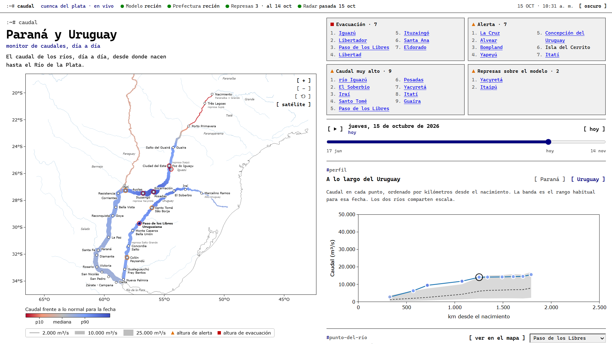

# Paraná y Uruguay



Caudal diario de los ríos Paraná y Uruguay, de sus nacientes al Río de la Plata. Incluye un mapa con zoom y fondo satelital opcional, el perfil a lo largo de cada río, la serie de cada punto, el pronóstico a 30 días, las alturas medidas, el caudal de las represas y la vista satelital.

Sin dependencias: solo Node 18+.

```
node server.mjs            # http://localhost:8080
PORT=3000 node server.mjs
```

Al arrancar, el servidor descarga los datos. La primera vez calcula también la climatología 2000–2024 de cada punto, lo que tarda unos minutos por los límites de la API. Después actualiza cada 3 horas.

## Datos

- **Caudal**: GloFAS (Copernicus Emergency Management Service) vía [Open-Meteo Flood API](https://open-meteo.com/en/docs/flood-api). Es un modelo hidrológico diario en una grilla de 0,05°, **no una medición**. Incluye 120 días hacia atrás y 31 de pronóstico (rango p25–p75 del ensamble).
- **Lo normal**: percentiles 10, 50 y 90 de 2000–2024 para cada fecha (ventana de ±10 días).
- **Afluentes del NEA** (Paraguay, Bermejo y Pilcomayo): cada uno se trata según qué tan bien lo sigue el modelo de caudal, que se comprobó contra 3 años de alturas medidas por el INA (correlación de la altura con el logaritmo del caudal GloFAS):

  | Río | Estación | Correlación | Cómo se muestra |
  |---|---|---|---|
  | Bermejo | El Colorado, Sauzalito | 0,88 y 0,92 | caudal modelado y pronóstico, como el Paraná y el Uruguay |
  | Paraguay | Formosa, Puerto Pilcomayo | 0,30 y 0,36 | caudal modelado solo en la desembocadura (0,77 en Isla del Cerrito); en los barrios, la altura medida por Prefectura |
  | Pilcomayo | Misión La Paz, Puesto Jerez, El Raúl | 0,0 a 0,2 | **sin caudal modelado**: trazo punteado y alturas medidas del INA (el cauce cambia y el río se pierde en los esteros) |

  Las alturas del Bermejo y el Pilcomayo vienen de la red de telemetría del INA (series "sat2", `sources/heights-ina.mjs`), sin niveles de alerta. Las trazas se agregan a `public/geo.json` con `scripts/add-tribs-geo.mjs` (a partir de las de Natural Earth).
- **Cartografía**: Natural Earth 10m. Solo agua (ríos, lagos, costa), sin límites políticos.

Fuentes complementarias (módulos opcionales en `sources/`; si uno falla, el resto sigue andando). Se actualizan cada hora y van a `data/extras.json`:

- **Respaldo de alturas** (`sources/heights-ina.mjs`): si Prefectura no responde (su sitio no es alcanzable desde el VPS), se usan las mismas escalas republicadas por el INA (red `alturas_prefe` de la API A5): 57 puertos, una lectura por día, con niveles de alerta y evacuación. Los que falten salen de `data/umbrales.json`, la última tabla conocida de Prefectura. La barra de estado indica "Alturas · vía INA".
- **Alturas medidas** (`sources/prefectura.mjs`): tabla de Prefectura Naval con altura, alerta, evacuación y tendencia de 91 hidrómetros. El servidor arma su propio histórico (`data/heights-history.json`) y lo completa de a poco con el histórico de 30 días de cada puerto. Pide como máximo 5 por hora, porque el sitio bloquea las ráfagas.
- **Represas** (`sources/dams.mjs`):
  - **Itaipú**: caudal erogado, vertido y nivel, de los datos abiertos del ONS (Brasil). Llega con 1 día de atraso.
  - **Yacyretá**: caudal erogado, del parte de la EBY republicado por el INA (A5).
  - **Salto Grande**: caudal erogado, vertido, aporte y cota, extraídos del sitio de la CTM (saltogrande.org; PDF diario más datos horarios). Cada día cuesta varios pedidos, así que la serie se guarda en `data/dam-saltogrande.json` y se piden solo los días que faltan, una vez por día. Los días anteriores a los últimos 3 se promedian con 4 lecturas horarias, con un error de pocos por ciento. **Ojo:** el sitio rechaza clientes que no se presentan como navegador, y el módulo envía un User-Agent genérico de navegador.
  - Las series de las tres represas se guardan en `data/dam-*.json`.
  - Se comparan con el modelo, que **no conoce las maniobras de compuertas**. Si una represa larga bastante más de lo que estima el modelo, la página lo avisa en las ciudades aguas abajo.
- **Estado de rutas nacionales** (`sources/vialidad.mjs`): lo que informa Vialidad Nacional en [Estado de rutas](https://www.argentina.gob.ar/transporte/vialidad-nacional/estado-de-rutas): habilitada, restringida, corte parcial o corte total por tramo, con observaciones y hora de actualización. La tabla de esa página sale de una planilla pública (hoja `tablavisible`) y el servidor lee esa misma planilla como CSV, a lo sumo cada 30 minutos. **Solo rutas nacionales**: las provinciales las informa cada provincia. Los textos de argentina.gob.ar están bajo CC BY 4.0.
- **Satélite** (`sources/satellite.mjs`): recorte de ~50 km alrededor de cada punto, cacheado en `data/sat/`.
  - **Fondo**: mosaico Sentinel-2 cloudless 2025 de EOX. Licencia CC BY-NC-SA 4.0: **solo uso no comercial**.
  - **Inundación**: Copernicus GFM (radar Sentinel-1, servidor de EODC). Se muestra **una pasada por vez**, la más reciente con detecciones en 14 días, con selector de las anteriores. Acumular días suma artefactos de borde de pasada, que se ven como franjas rectas sobre campos secos.

## Mapa (barrios populares y más capas)

Página aparte (`/mapa.html`, enlace "mapa" en la barra superior): un mapa casi a pantalla completa, con zoom hasta cada barrio, que cruza el caudal con el [Registro Nacional de Barrios Populares](https://datos.gob.ar/dataset/registro-nacional-de-barrios-populares) (RENABAP, Secretaría de Integración Socio Urbana, CC BY 4.0). La vista y el barrio elegido van en la URL (`#zoom/lat/lon/bID`), así que se puede compartir un barrio.

**Capas** (panel de la izquierda). La inundación observada por el radar (Copernicus GFM) no está en este mapa: se ve en el monitor, en "desde el satélite" de cada punto.

- **Satélite**: mosaico Sentinel-2 cloudless, de la misma grilla de mosaicos que usa el monitor, hasta ~10 m por píxel.
- **Barrios populares**: un punto por barrio (más grande cuantas más familias), que de cerca pasa a ser su contorno. El color es la **altura sobre el agua más cercana** (violeta oscuro = bajo, claro = alto): una medida de exposición que no cambia con la fecha. Con la barra de abajo se elige una fecha y solo se marcan de rojo los barrios que el río alcanza en ella (inundación probable) y de naranja los que están a menos de 1 m (posible). Ficha corta con familias, altura sobre el agua y el estado en la fecha elegida. Búsqueda por barrio o localidad.
- **Estado de rutas nacionales**: los tramos de rutas nacionales que Vialidad Nacional informa con corte total, corte parcial o restricción, dibujados sobre la traza de la ruta, sin listado: al pasar el cursor por uno se ve el tramo, el estado, la calzada, el largo, la hora de actualización y la observación oficial. **Es lo que informa Vialidad, no una estimación nuestra** (probamos estimarlo con el terreno y lo descartamos: el modelo de elevación no ve los terraplenes sobre los que van las rutas). La **ubicación es aproximada**: la planilla de Vialidad nombra los tramos por localidades y no trae geometría, así que el servidor los ubica con la traza del IGN y la API Georef (`sources/vialidad-geo.mjs`), y solo dibuja los que coinciden con los km oficiales; los demás (límites provinciales, empalmes con rutas provinciales, accesos) no se dibujan. Solo rutas nacionales: las provinciales las informa cada provincia.
- **Localidades**: los gobiernos locales de las ocho provincias (las del Litoral, Neuquén y Río Negro) (Registro Federal de Gobiernos Locales) y las ciudades vecinas de Paraguay, Brasil y Uruguay. El criterio es la población (Censo 2022): se muestran solo las de más de 150.000 habitantes con el mapa alejado y el piso baja a medida que se acerca el zoom (50.000, 20.000, 8.000, 3.000, 1.000, todas). Si dos nombres se pisan, queda el de la ciudad más grande.
- **Ríos y puntos de medición**: la traza esquemática de los ríos grandes y las estaciones del monitor, más los ríos del **Comahue** (Neuquén, Limay, Negro y Colorado, la cuenca de Vaca Muerta) y los **ríos menores** (Corriente, Santa Lucía, Miriñay, Batel, Aguapey, Mocoretá, Gualeguay, Nogoyá, Feliciano, Guayquiraró, Riachuelo, Negro del Chaco, Piray Guazú y Miní, Colastiné, Leyes, Coronda, Malabrigo, Las Garzas y Barrancas) con las boyas hidrométricas del INA, y todas las **escalas de Prefectura** (republicadas por el INA) con su altura de hoy y sus niveles de alerta y evacuación. Los puertos aparecen desde el zoom 7. Se ve el valor al pasar el cursor.


**Cómo se estima la exposición** (`public/rise.js`):

- **Altura sobre el río** (`scripts/build-barrios.mjs` → `public/barrios.json`): para cada barrio a menos de 12 km del Paraná, el Uruguay, el Paraguay o el Bermejo (o a menos de 4 km de uno de los ríos menores, si le queda más cerca), cota del terreno (SRTM 30 m de la NASA, vía [OpenTopoData](https://www.opentopodata.org/)) menos la cota del río en el punto más cercano. El río se toma como el mínimo de los puntos vecinos de su traza, porque el modelo de elevación aplana el agua.
- **Subida del río** (`scripts/build-ratings.mjs` → `public/ratings.json`): metros que sube el río por cada vez que se multiplica el caudal (h = a + b·ln Q), ajustados con ~3 años de alturas de Prefectura (vía INA) contra el caudal GloFAS de cada estación. Para cada fecha, la subida respecto del caudal mediano; desde la emisión del pronóstico del INA, la subida sigue lo que pronostica el INA para ese puerto.
- **Estado**: inundación probable si la subida del río supera la altura del barrio; posible si le falta menos de un metro; poco probable en el resto.
- **Bermejo y Paraguay** (`scripts/lib/rio.mjs`, `scripts/build-ratings.mjs`): el **Bermejo** usa la curva altura–caudal de El Colorado (2,2 m por cada vez que se multiplica el caudal, correlación 0,88), solo en el tramo bajo (desde Puerto Lavalle hacia abajo: aguas arriba, Embarcación y Orán son un río de piedemonte con crecidas torrenciales, donde esta cuenta no vale). El **Paraguay** no tiene curva ni pronóstico: la subida de cada día es la altura medida en Formosa o Puerto Pilcomayo (Prefectura) menos su mediana de 3 años, así que solo hay valor para los días con medición, hasta hoy. En el **Pilcomayo** no se estima nada.
- **Ríos menores** (`scripts/build-cauces.mjs` → `public/cauces.json`, `sources/gauges-extra.json`; `scripts/build-ratings.mjs cauces`): la traza sale de OpenStreetMap (ODbL), de la que se arma la cadena principal de cada río, y las boyas son las de la red de telemetría del INA ("sat2", altura hidrométrica). **Sin pronóstico**: el modelo de caudal (GloFAS) no sigue estos cauces y el INA no los pronostica. Como en el Paraguay, la subida de un día es la altura medida menos su mediana de los últimos tres años, y solo hay estimación para los días con medición. La altura del barrio sobre un arroyo es más incierta que sobre un río grande: el modelo de elevación (30 m) no distingue un cauce angosto. Un barrio se asigna al curso más cercano; si es un río menor, solo cuenta a menos de 4 km y a menos de 10 m sobre el agua, y si el terreno queda por debajo del nivel del río (el modelo de elevación no distingue el cauce), se marca "sin dato confiable" y no se estima.
- **Comahue · Vaca Muerta** (botón "Comahue · Vaca Muerta" bajo el buscador): el Neuquén, el Limay, el Negro y el Colorado entran por el mismo camino que los ríos menores (traza de OpenStreetMap, boyas del INA: Chos Malal, Paso de Indios, Dique Ballester y Neuquén en el Neuquén; Isla Jordán, Paso Córdova y Primera Angostura en el Negro; Pata Mora, Puesto Hernández, Pichi Mahuida, Paso Alsina y Pedro Luro en el Colorado). **Caudales regulados**: las represas del Comahue (Alicurá, Piedra del Águila, Pichi Picún Leufú, El Chocón, Arroyito) manejan el río y el modelo de caudal no las ve, así que solo cuenta la altura medida, y esa altura varía poco (la diferencia entre un día bajo y uno alto es de uno o dos metros): una crecida de verdad solo la dan las maniobras de las represas. El Limay no tiene boya propia con datos: se usa la del Negro en Isla Jordán, aguas abajo de la confluencia. La ubicación del rótulo "Vaca Muerta" es aproximada (la zona principal de la formación) y no un límite. Los mosaicos satelitales cubren hasta 72,5°O y 42°S.
- **Represas del Comahue** (casilla propia, `scripts/build-represas.mjs` → `public/represas.json`): 11 represas y diques del Limay (Alicurá, Piedra del Águila, Pichi Picún Leufú, El Chocón, Arroyito) y del Neuquén (el complejo Cerros Colorados: Portezuelo Grande, Mari Menuco, Loma de la Lata, Planicie Banderita, El Chañar, y el dique Ingeniero Ballester). Cuadrados celestes; el nombre aparece desde el zoom 8 y la potencia, al pasar el cursor. Ubicación y potencia de [OpenStreetMap](https://www.openstreetmap.org/) (ODbL), lista curada a mano (hay cientos de muros de canales de riego sin nombre que no se muestran). No cambian la estimación: el mapa no modela las maniobras.
- **Escalas de Prefectura** (`scripts/build-puertos.mjs` → `public/puertos.json`, `sources/gauges-extra.json`): ubicación y niveles de alerta de las escalas de la red de Prefectura. Las que el monitor no usa (Delta, Río de la Plata, represas) se suman a las series que consulta el servidor, marcadas `grp: 'pna'`, y solo aparecen en el mapa.
- **Qué no es**: una **estimación**, no un aviso oficial. El modelo de elevación puede errar varios metros (ve techos y árboles), la subida sale de un modelo, y no se consideran defensas, desagües ni lluvia local. No hay estimación donde la altura del río depende de las represas (Paraná arriba de Yacyretá), en el Delta (marea), en el Pilcomayo ni en el Bermejo alto. En el Chaco, muy llano, el error del modelo de elevación (varios metros) puede ser mayor que el relieve: ahí las estimaciones son menos confiables que en el Litoral.
- **Municipios** (`scripts/build-municipios.mjs` → `public/municipios.json`): misma idea que los barrios; las descargas se cachean en `data/cache/`.
- Los scripts se corren a mano cuando se quiera actualizar (`node scripts/build-barrios.mjs`, `node scripts/build-municipios.mjs`, `node scripts/build-ratings.mjs`); las respuestas de elevación se cachean en `data/cache/`.

**Compartir** (`public/share.js`): tres íconos debajo del selector de fecha, en el mapa y en el monitor: WhatsApp, X y copiar enlace. Comparten el estado del momento: el enlace del mapa lleva la vista, el barrio elegido y, si no es hoy, la fecha (`#zoom/lat/lon[/bID][/dAAAA-MM-DD]`); el del monitor, la estación (`#rosario`). El texto resume lo que se ve (por ejemplo, el barrio, sus familias, la altura sobre el agua y si el río lo alcanza ese día). Las páginas tienen etiquetas Open Graph y de Twitter con una imagen de vista previa (`public/og-mapa.jpg`, `public/og-monitor.jpg`, 1200×630): son estáticas, así que el enlace de un barrio muestra la vista previa general del mapa y el barrio se abre al tocar el enlace. Hay que regenerar esas imágenes (una captura de la página) si cambia mucho el aspecto.

**Sumar una capa**: `public/mapa.js` tiene un motor propio y sin dependencias. Una capa raster por mosaicos es una entrada en `LAYERS` (una función `(nivel, fila, columna) → URL`) más una casilla en el panel; una capa vectorial se dibuja en `renderVec()`, que reproyecta en cada cuadro.

Uso no comercial gratuito en Open-Meteo. Para uso comercial o alto tráfico, revisar sus [términos](https://open-meteo.com/en/terms).

## Archivos

| | |
|---|---|
| `server.mjs` | servidor HTTP + recolector |
| `stations.json` | puntos de cada río (nombres, coordenadas nominales): `main` y `tributaries` del Paraná, `uruguay` |
| `data/stations.calibrated.json` | puntos ajustados a la celda del cauce en GloFAS |
| `data/climatology.json`, `data/latest.json` | caché (se regeneran solos) |
| `public/` | interfaz (HTML + JS + CSS, sin build) |
| `scripts/calibrate.mjs` | recalibra los puntos tras editar `stations.json` |
| `scripts/build-geo.mjs` | regenera `public/geo.json` desde Natural Earth |
| `public/mapa.html`, `mapa.js`, `mapa.css` | página del mapa (motor de mapa propio) |
| `public/rise.js` | cuánto sube el río en cada estación y fecha (curva altura–caudal + pronóstico INA) |
| `public/cauces.json`, `public/puertos.json`, `sources/gauges-extra.json` | ríos menores, escalas de Prefectura y las series extra del INA; los generan `scripts/build-cauces.mjs` y `scripts/build-puertos.mjs` |
| `public/represas.json` | las represas del Comahue; la genera `scripts/build-represas.mjs` |
| `public/rutas.js` | capa de rutas del mapa (estado oficial de Vialidad) |
| `sources/vialidad.mjs`, `sources/vialidad-geo.mjs`, `sources/rutas-nacionales.json` | estado de rutas nacionales y su ubicación sobre la traza; la traza la genera `scripts/build-rutas-geo.mjs` |
| `public/barrios.json`, `public/municipios.json`, `public/ratings.json` | datos de las capas; los generan los `scripts/build-*.mjs` |

### Agregar o mover un punto

1. Editar `stations.json`.
2. `node scripts/calibrate.mjs`: elige la celda con mayor caudal cerca del punto (el cauce principal).
3. `node scripts/build-geo.mjs <carpeta-natural-earth>`: recalcula el km de cada punto. Necesita `ne_10m_rivers_lake_centerlines`, `ne_10m_lakes` y `ne_10m_coastline` en GeoJSON, de [natural-earth-vector](https://github.com/nvkelso/natural-earth-vector/tree/master/geojson).
4. Agregar sus etiquetas en `SHORES` (`public/app.js`).
5. Reiniciar el servidor. La climatología del punto nuevo se calcula sola.

## VPS

Pensado para un VPS con Ubuntu 24.04 y Caddy. El servicio `caudal` escucha en `127.0.0.1:8787` detrás de Caddy. El código está en `/opt/caudal/app` y los datos en `/opt/caudal/data`.

1. **Subir la semilla** al home del usuario de deploy: la app en `~/caudal-seed/app` y, opcionalmente, las cachés en `~/caudal-seed/data`, que evitan volver a pedirles todo a las APIs.
2. **Instalación inicial**, una sola vez y con sudo:

   ```
   sudo DOMAIN=caudal.ejemplo.org bash ~/caudal-seed/app/deploy/install-root.sh
   ```

   Instala Node desde apt y crea el usuario `caudal` y el servicio systemd endurecido. Agrega el sitio al Caddyfile (con respaldo y validación) y una regla de sudo acotada para reiniciar el servicio. El dominio se pasa en `DOMAIN`; el puerto se cambia al principio del script.
3. **Deploy de versiones nuevas**, sin sudo:

   ```
   SSH_HOST=mi-servidor bash deploy/deploy.sh
   ```

   Deja `app.prev` para volver atrás.

Alcanza con 1 vCPU y 1 GB de RAM. El disco crece con la caché satelital (unos 20 MB al arrancar).

## Rendimiento

Pensado para que el tráfico de los usuarios no se traslade a los servicios externos:

- **Datos**: se descargan en el servidor cada 1–3 horas, sin importar cuántos visitantes haya.
- **Respuestas**: comprimidas con brotli o gzip una sola vez por archivo y guardadas en memoria. Llevan `ETag`: si el archivo no cambió, el navegador recibe un 304 vacío. Una visita completa pesa ~95 KB.
- **Satélite**: mosaicos de grilla fija (EOX, lat/lon, 256 px) guardados en disco para siempre, con `Cache-Control: immutable`. Al arrancar se precalientan la cuenca (niveles 4–6) y cada ciudad (niveles 8–9). Hay un tope global de 3.000 mosaicos nuevos por hora.
- **Servicios externos**: los pedidos en curso se comparten (si 20 personas abren la misma ciudad, sale uno solo). Hay un límite de pedidos simultáneos por servicio (GFM 4, EOX 6). Las pasadas del radar de todas las ciudades se precalculan cada hora.
- **Límite por IP** en `/api/sat/*` y `/api/tiles/*`, holgado a propósito porque con CGNAT muchas personas comparten IP. Detrás de un proxy hace falta `TRUST_PROXY=1`.
- **Picos**: si el link circula masivamente, conviene poner Cloudflare (gratis) delante. Los mosaicos `.jpg` se cachean solos. Para `/api/data` y `/api/extras` hay que crear una regla de caché que respete el `max-age=300` del origen.

## Estadísticas

Contador propio (`analytics.mjs`), sin dependencias, sin cookies y sin terceros.

- **Visitas:** se cuentan las cargas de la página. Bots y clientes automatizados (buscadores, `curl`, navegadores sin interfaz, monitores) no cuentan.
- **Visitantes únicos:** hash de la sal del día + IP + navegador. La IP no se guarda, y la sal se descarta al cambiar el día, así que no se puede seguir a nadie de un día a otro.
- **Qué se guarda:** solo totales por día, durante 400 días, en `data/analytics.json`: visitas (por página, monitor o mapa), únicos, celular o compu, dominio de origen, localidades consultadas y compartidos: cuántas veces se tocó cada botón de compartir (WhatsApp, X, copiar enlace) y cuántas visitas llegaron por esos enlaces, que llevan `?via=wa`, `?via=x` o `?via=link`. Las localidades las avisa la página al elegir una, con un `sendBeacon` de pocos bytes.
- **Página `/stats`:** privada. Sin la clave responde 404. La clave se genera la primera vez en `data/stats-key` y se anuncia una sola vez en el log del servicio:

```
ssh mi-servidor "sudo -n /usr/bin/journalctl -u caudal --no-pager -n 100 | grep -o 'https?://[^ ]*stats?key=[^ ]*|/stats?key=[^ ]*'"
```

Para cambiar la clave, borrá `/opt/caudal/data/stats-key` (con sudo) y reiniciá el servicio.

**Monitoreo**: `GET /health` devuelve la antigüedad de cada fuente, los errores y los pedidos salientes por servicio. Responde **503** si el modelo tiene más de 6 h o las fuentes complementarias más de 3 h. Sirve para un chequeo externo como UptimeRobot.

**Prueba de carga**: con el servidor corriendo con `RATE_LIMIT=0`, ejecutar `node scripts/loadtest.mjs 100`. Simula 100 usuarios que cargan la página, abren 3 ciudades, exploran el satélite y vuelven con caché.
- **Caché caliente:** mediana de 8 ms, percentil 95 de 20 ms, ~1.600 pedidos por segundo y ningún pedido saliente.
- **Caché fría:** cada mosaico distinto se pide una sola vez hacia EOX (310 en total para 100 usuarios).

## Licencia

El código está bajo licencia [MIT](LICENSE). Los datos y las imágenes que la app consulta tienen sus propias condiciones:

- GloFAS y Sentinel: Copernicus, uso libre con atribución.
- Mosaico Sentinel-2 cloudless de EOX: CC BY-NC-SA 4.0, solo uso no comercial.
- Natural Earth: dominio público.
- Prefectura, INA, ONS, EBY y CTM Salto Grande: datos publicados por cada organismo.
